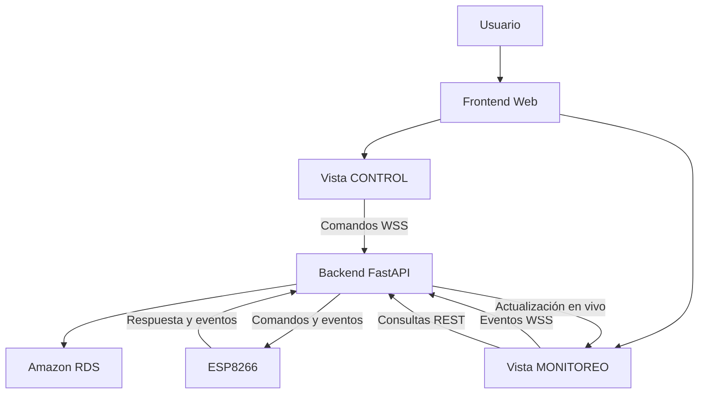

# 🚗 Sistema de Control y Monitoreo de Vehículos IoT

Aplicación web desarrollada para controlar y monitorear un vehículo mediante tecnología IoT, integrando una interfaz web, una API REST, comunicación WebSocket segura (WSS), una base de datos relacional y un microcontrolador ESP8266.

El sistema permite enviar comandos de movimiento desde una interfaz web, visualizar eventos de comunicación en tiempo real y consultar los movimientos registrados.

## 🌐 Acceso al proyecto

- **Frontend:** [Control IoT - GitHub Pages](https://yolotzingranados.github.io/Control-IoT-frontend/)
- **Repositorio Frontend:** [Control-IoT-frontend](https://github.com/YolotzinGranados/Control-IoT-frontend)
- **Repositorio Backend:** [APIVehiculoWebSocketIoT](https://github.com/YolotzinGranados/APIVehiculoWebSocketIoT)

## 📋 Características principales

La aplicación cuenta con dos vistas principales:

### 1. CONTROL

Interfaz destinada al manejo del vehículo mediante un joystick virtual.

Funciones principales:

- Control de movimientos hacia adelante y atrás.
- Movimiento hacia la izquierda y derecha.
- Control de la pala del vehículo.
- Envío de comandos al servidor mediante comunicación WebSocket.
- Identificación del vehículo mediante su ID.
- Modo DEMO para realizar pruebas de funcionamiento de la interfaz.
- Diseño adaptable a computadoras, tabletas y teléfonos móviles.

### 2. MONITOREO

Interfaz destinada a visualizar los eventos y movimientos registrados por el sistema.

Funciones principales:

- Tarjeta informativa del último movimiento recibido.
- Visualización de fecha y hora del último evento.
- Tabla responsiva con el historial de movimientos registrados.
- Actualización de información mediante WebSocket seguro (WSS).
- Recuperación de información mediante solicitudes REST.
- Visualización de registros provenientes del backend.
- Adaptación de la interfaz a diferentes tamaños de pantalla.

## 🏗️ Arquitectura del sistema

El proyecto utiliza una arquitectura distribuida en la que cada componente cumple una función específica.

| Componente | Función |
|---|---|
| Frontend | Interfaz de control y monitoreo. |
| API REST | Consulta y recuperación de información. |
| WebSocket WSS | Comunicación de eventos en tiempo real. |
| Backend FastAPI | Procesamiento de solicitudes y gestión de eventos. |
| Amazon RDS | Almacenamiento de información e historial. |
| ESP8266 | Recepción de comandos y control físico del vehículo. |

### Diagrama general de arquitectura



## 🔄 Comunicación del sistema

El sistema utiliza dos mecanismos de comunicación que cumplen funciones diferentes.

### API REST

Se utiliza para:

- Obtener información inicial.
- Consultar los movimientos almacenados.
- Recuperar información después de una desconexión.
- Solicitar nuevamente los registros disponibles en el servidor.

### WebSocket seguro (WSS)

Se utiliza para:

- Enviar comandos desde la interfaz de control.
- Recibir eventos en tiempo real.
- Actualizar la vista de monitoreo sin recargar la página.
- Sincronizar la información entre diferentes sesiones abiertas de la aplicación.

La conexión WSS permite mantener una comunicación bidireccional entre los clientes y el servidor.

### Recuperación de conexión

Cuando ocurre una interrupción de red, la aplicación debe restablecer la conexión WebSocket y recuperar mediante REST la información necesaria para sincronizar nuevamente el estado del monitoreo.

## 🗄️ Gestión de datos

El backend administra la información y utiliza una base de datos relacional Amazon RDS.

La información se organiza para relacionar los vehículos, los comandos y los registros de movimientos.

El historial permite consultar los eventos que han sido registrados y almacenados por el backend.

Es importante distinguir los siguientes conceptos:

- **Último movimiento:** movimiento o evento más reciente que se presenta en la interfaz.
- **Evento:** mensaje o acción de comunicación recibido por el sistema.
- **Historial:** conjunto de registros almacenados en la base de datos.
- **Ejecución física:** movimiento realizado efectivamente por los actuadores del vehículo.

La recepción de un comando o evento no garantiza por sí misma que el vehículo haya ejecutado físicamente el movimiento.

Los movimientos internos generados por el modo DEMO no aparecen automáticamente en el historial si no son enviados al backend y registrados en la base de datos.

## 🛠️ Tecnologías utilizadas

### Frontend
- HTML5.
- CSS3.
- JavaScript.
- Bootstrap 5.
- WebSocket API.
- GitHub Pages.

### Backend e infraestructura
- Python.
- FastAPI.
- REST API.
- WebSocket seguro (WSS).
- Amazon Web Services (AWS).
- Amazon RDS.
- HTTPS y certificados SSL/TLS.

### Hardware
- ESP8266.
- Arduino IDE.
- Módulos electrónicos de control del vehículo.

## 📱 Diseño responsivo

La aplicación utiliza un enfoque de diseño Mobile First para facilitar su utilización desde dispositivos móviles.

Se consideran los siguientes aspectos:

- Distribución adaptable de los componentes.
- Controles accesibles desde pantallas pequeñas.
- Tabla de monitoreo adaptable.
- Navegación entre las vistas CONTROL y MONITOREO.
- Organización de la información para evitar desbordamientos horizontales.

## 🔐 Seguridad

La comunicación entre el frontend y el backend utiliza protocolos seguros:

- HTTPS para el acceso a los servicios REST.
- WSS para la comunicación WebSocket.
- Certificados SSL/TLS para proteger la transmisión de información.

La versión actual del proyecto no requiere el envío de una API Key desde el frontend.

La seguridad de la infraestructura también depende de la configuración del servidor, las reglas de acceso, los certificados y la protección de la base de datos.

## ⚙️ Instalación y ejecución local

### Requisitos

- Navegador web actualizado.
- Visual Studio Code (recomendado).
- Conexión a Internet.
- Backend disponible y configurado.
- Servicio WebSocket activo.

### Pasos de instalación

1. Clonar el repositorio:

```bash
git clone https://github.com/YolotzinGranados/Control-IoT-frontend.git
```

2. Entrar al directorio:

```bash
cd Control-IoT-frontend
```

3. Abrir el proyecto en Visual Studio Code.

4. Revisar el archivo de configuración del frontend y verificar las direcciones de conexión de la API REST y del WebSocket.

5. Ejecutar el proyecto mediante una extensión como Live Server o un servidor HTTP local.

6. Abrir la aplicación desde el navegador.

**Nota:** El backend debe estar disponible y las direcciones de conexión deben corresponder a los servicios desplegados.

## 🚀 Despliegue

El frontend se publica mediante GitHub Pages.

Repositorio:

https://github.com/YolotzinGranados/Control-IoT-frontend

Dirección de acceso:

https://yolotzingranados.github.io/Control-IoT-frontend/

Para actualizar la aplicación:

1. Realizar los cambios en los archivos del proyecto.
2. Verificar el funcionamiento local.
3. Guardar los cambios.
4. Enviar los cambios al repositorio:

```bash
git add .
git commit -m "Actualización del frontend IoT"
git push origin main
```

5. Esperar a que GitHub Pages publique la nueva versión.

## 🧪 Pruebas y validaciones

Para verificar el funcionamiento del sistema se consideran las siguientes pruebas:

| Prueba | Resultado esperado |
|---|---|
| Carga inicial | Recuperación de información mediante REST. |
| Conexión WSS | Establecimiento de comunicación con el backend. |
| Envío de comandos | Recepción del comando por el servidor. |
| Monitoreo en vivo | Actualización de eventos sin recargar la página. |
| Segunda pestaña | Visualización de eventos generados desde otra sesión. |
| Reconexión | Recuperación de comunicación y sincronización. |
| Historial | Consulta de registros almacenados en RDS. |
| Modo DEMO | Prueba de controles sin asumir persistencia automática. |
| Diseño responsivo | Funcionamiento en computadoras y dispositivos móviles. |

## 🔮 Mejoras futuras

- Incorporación de más vehículos.
- Administración de vehículos desde una interfaz independiente.
- Gestión de usuarios y permisos.
- Ampliación del historial de movimientos.
- Incorporación de indicadores del estado de conexión.
- Registro de confirmaciones de ejecución física.
- Mejoras en la supervisión y diagnóstico de dispositivos IoT.

## 👨‍💻 Autoría

**Proyecto:** Sistema de Control y Monitoreo de Vehículos IoT.

**Desarrollo:** Yolotzin Granados.

**Repositorio:** Control-IoT-frontend.

---

*Proyecto de integración de tecnologías web, comunicación en tiempo real, servicios en la nube y sistemas embebidos para el control y monitoreo de vehículos mediante Internet de las Cosas (IoT).*